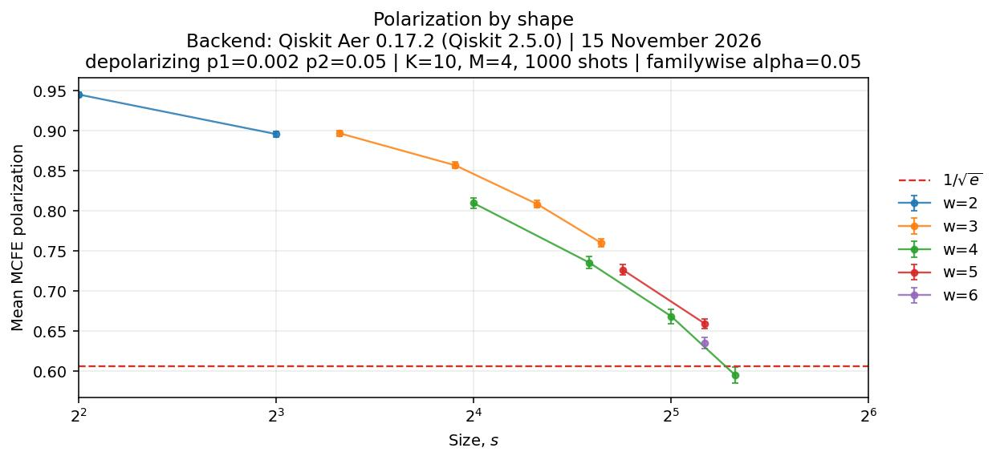

# QUOPS - Prototype Benchmark Program

QUOPS measures how large a circuit a quantum computer can run reliably, and how fast it delivers
useful operations at that size. It is described in *Benchmarking the computational power of quantum
computers* [[1]](#references), and this implementation follows the reference code maintained in the
PRAQTICE repository [[2]](#references).

> **Status: preview.** This version runs on simulators only (Qiskit Aer, and CUDA-Q on CPU or GPU).
> Running on real hardware through the QED-C execution library is planned.

## Problem outline

QUOPS reports two numbers for a device:

- **Q**, the capability score: the size *s* (the number of gate operations) of the largest random
  circuit the device runs with a mean process polarization above the threshold 1/√e ≈ 0.61.
- **Ω** (omega), the rate: how many useful operations per second the device delivers at that size.
  On a simulator this is a wall-clock figure, not a hardware rate.

Circuits are described by their *shape*, a width *w* (qubits) and a size *s*. Only shapes in the
*utility cone* w² ≤ s ≤ w³ count towards Q.

## Benchmarking

The benchmark scans shapes in increasing size, from `min_qubits` to `max_qubits`, and tests each one:

1. Build `max_circuits` random circuits of that shape (layers of two-qubit and single-qubit gates).
2. Turn each circuit into mirror circuits, each run `num_mirrors` times with `num_shots` shots, in
   three ensembles (mirror circuit fidelity estimation, MCFE):
   - **BR**: the circuit followed by a randomly compiled inverse,
   - **RR**: a randomly compiled circuit followed by a randomly compiled inverse,
   - **REF**: no circuit, only the random single-qubit Clifford layers that start and end every
     mirror circuit, to measure state preparation and measurement errors.
3. Combine the three as λ = γ(BR) / (√γ(RR) · √γ(REF)), which cancels most of the error that does
   not come from the circuit itself, and bootstrap a lower confidence bound on λ.
4. The shape passes if that lower bound is above 1/√e. The scan stops after `max_failures` failed
   shapes (default 1), keeping the total chance of a false pass at 5%.

Q is the size of the largest passing shape in the utility cone. Each run is saved to
`__data/<backend_id>/QUOPS-results.json`, and two plots are saved under `__images/<backend_id>/`:

<p align="center">

</p>

*Fig 1. Shapes tested, inside the utility cone; green passed, red failed, the circled point gives Q.*

<p align="center">

</p>

*Fig 2. Mean MCFE polarization for each shape, one line per width, with the 1/√e threshold.*

Both runs above use the default depolarizing noise model (1-qubit error 0.002, 2-qubit error 0.05),
which gives Q = 36 at (w=5, s=36).

## Running the benchmark

From the command line, in the folder where results should be written:

```
python qedcbench/quops/quops_benchmark.py                 # Qiskit Aer, depolarizing noise
python qedcbench/quops/quops_benchmark.py -a cudaq        # CUDA-Q on the GPU (nvidia target)
python qedcbench/quops/quops_benchmark.py --noise none    # noiseless: every shape passes
```

From Python or a notebook (`quops_benchmark.ipynb` in this folder):

```python
from qedcbench.quops import quops_benchmark
result = quops_benchmark.run(api="qiskit", min_qubits=2, max_qubits=6)
quops_benchmark.plot_results("qasm_simulator")      # remake the plots from saved data
```

Main options (`python quops_benchmark.py --help` lists all): `min_qubits`/`max_qubits`,
`max_depth` (default 3 × width), `max_circuits` (default 10), `num_mirrors` (default 4),
`num_shots` (default 1000), `max_failures` (default 1), `noise` (`depolarizing` or `none`),
`api` (`qiskit` or `cudaq`) and `backend_id` (for CUDA-Q, the target, e.g. `density-matrix-cpu`).

QUOPS is not part of the suite notebooks or `run_all.py`; run it on its own.

## Implementation notes

- The scan loop is in `quops_benchmark.py`; `qiskit_kernel/quops_kernel.py` and
  `cudaq_kernel/quops_kernel.py` build and run the circuits; shared math, statistics and plotting
  are in `_common/quops_fctns.py`.
- The CUDA-Q kernel runs every mirror circuit through one kernel compiled once, which is much faster
  than compiling a kernel per random circuit.
- Differences from the reference code [[2]](#references): the scan stops at the first failure
  instead of measuring all declared shapes and then testing them as a family, and the Qiskit kernel
  is our own (the reference code is CUDA-Q only).
- Requires `pandas` in addition to the base packages.

## References

[1] Timothy Proctor et al. (2026).
    Benchmarking the computational power of quantum computers.
    [`arXiv:2609.12146`](https://arxiv.org/abs/2609.12146)

[2] PRAQTICE, QUOPS reference implementation (CUDA-Q).
    [`sandialabs/PRAQTICE, quops branch`](https://github.com/sandialabs/PRAQTICE/tree/quops/quops/implementations/cudaq)
