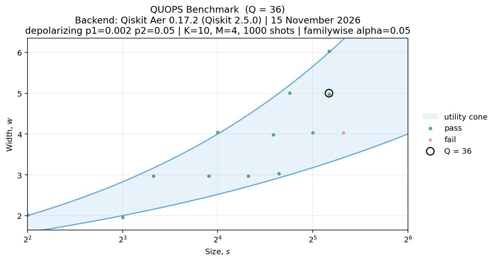

# QUOPS - Prototype Benchmark Program

QUOPS measures how large a circuit a quantum computer can run reliably, and how fast it delivers
useful operations at that size. It is described in *Benchmarking the computational power of quantum
computers* [[1]](#references), and this implementation follows the reference code maintained in the
PRAQTICE repository [[2]](#references).

> **Status: preview.** This version runs on simulators only (Qiskit Aer, and CUDA-Q on CPU or GPU).
> Running on real hardware through the QED-C execution library is planned.

## Problem outline

QUOPS reports two numbers for a device:

- **Q**, the capability score: the size *s* (the number of gate operations) of the largest random
  circuit the device runs with a mean process polarization above the threshold 1/√e ≈ 0.61.
- **Ω** (omega), the rate: how many useful operations per second the device delivers at that size.
  On a simulator this is a wall-clock figure, not a hardware rate.

Circuits are described by their *shape*, a width *w* (qubits) and a size *s*. Only shapes in the
*utility cone* w² ≤ s ≤ w³ count towards Q.

## Benchmarking

The benchmark scans shapes in increasing size, from `min_qubits` to `max_qubits`, and tests each one:

1. Build `max_circuits` random circuits of that shape (layers of two-qubit and single-qubit gates).
2. Turn each circuit into mirror circuits, each run `num_mirrors` times with `num_shots` shots, in
   three ensembles (mirror circuit fidelity estimation, MCFE):
   - **BR**: the circuit followed by a randomly compiled inverse,
   - **RR**: a randomly compiled circuit followed by a randomly compiled inverse,
   - **REF**: no circuit, only the random single-qubit Clifford layers that start and end every
     mirror circuit, to measure state preparation and measurement errors.
3. Combine the three as λ = γ(BR) / (√γ(RR) · √γ(REF)), which cancels most of the error that does
   not come from the circuit itself, and bootstrap a lower confidence bound on λ.
4. The shape passes if that lower bound is above 1/√e. The scan stops after `max_failures` failed
   shapes (default 1), keeping the total chance of a false pass at 5%.

Q is the size of the largest passing shape in the utility cone. Each run is saved to
`__data/<backend_id>/QUOPS-results.json`, and two plots are saved under `__images/<backend_id>/`:

<p align="center">

</p>

*Fig 1. Shapes tested, inside the utility cone; green passed, red failed, the circled point gives Q.*

<p align="center">

</p>

*Fig 2. Mean MCFE polarization for each shape, one line per width, with the 1/√e threshold.*

Both runs above use the QUOPS noise model (`--noise quops`: depolarizing, 1-qubit error 0.002,
2-qubit error 0.05, the model of the reference code [[2]](#references)), which gives Q = 36 at
(w=5, s=36). By default QUOPS uses qedclib's noise model for the simulator, as the other benchmarks
do; on Qiskit that model gives Q of roughly 350-400, at widths 8-11.

## Running the benchmark

From the command line, in the folder where results should be written:

```
python qedcbench/quops/quops_benchmark.py                 # Qiskit Aer, qedclib's default noise model
python qedcbench/quops/quops_benchmark.py --noise quops   # QUOPS noise model: Q = 36
python qedcbench/quops/quops_benchmark.py -a cudaq --noise quops   # CUDA-Q on the GPU (nvidia target)
python qedcbench/quops/quops_benchmark.py --nonoise       # noiseless: every shape passes
python qedcbench/quops/quops_benchmark.py --probe -min 6 -max 12   # estimate where the boundary is (not a Q)
python qedcbench/quops/quops_benchmark.py -b fake_fez -max 3 -c 3 --num_mirrors 2   # an IBM fake backend
```

From Python or a notebook (`quops_benchmark.ipynb` in this folder):

```python
from qedcbench.quops import quops_benchmark
result = quops_benchmark.run(api="qiskit", min_qubits=2, max_qubits=6)
quops_benchmark.plot_results("qasm_simulator")      # remake the plots from saved data
```

Main options (`python quops_benchmark.py --help` lists all): `min_qubits`/`max_qubits`,
`max_depth` (default 3 × width), `max_circuits` (default 10), `num_mirrors` (default 4),
`num_shots` (default 1000), `max_failures` (default 1), `noise` (`default`, `quops` or `none`;
`--nonoise` on the command line), `api` (`qiskit` or `cudaq`) and `backend_id` (a qedclib backend
id; for CUDA-Q, the target, e.g. `density-matrix-cpu`). `exec_options` are passed to qedclib as for
the other benchmarks (with `noise = "default"`, a `noise_model` given there is used).

**Probe mode** (`--probe`, or `quops_benchmark.run_probe(...)`): a cheap estimate of where the
boundary lies before a full scan, for example on hardware. It runs a few shapes per width
(`--points_per_width`, default 3), 2 circuits × 1 mirror each unless `-c` / `--num_mirrors` are given,
never stops at a failure, and prints for each width the size where λ reaches 1/√e. It doesn't report a Q.

**Hardware:** circuits run through qedclib, one batch per shape, so any qedclib backend can be used.
Each circuit has barriers between its four parts and is transpiled at optimization level 1, so the
transpiler can't cancel the mirror; on a device backend QUOPS prints each shape's two-qubit gate count
before and after transpiling. Omega is not reported on hardware. A run can be stopped between shapes
(`qedclib.execute.request_cancel()`); the shapes finished so far are saved.

QUOPS is not part of the suite notebooks or `run_all.py`; run it on its own.

## Implementation notes

- The scan loop is in `quops_benchmark.py`; `qiskit_kernel/quops_kernel.py` and
  `cudaq_kernel/quops_kernel.py` build the circuits, which run through qedclib; shared math,
  statistics and plotting are in `_common/quops_fctns.py`.
- The CUDA-Q kernel runs every mirror circuit through one kernel compiled once, which is much faster
  than compiling a kernel per random circuit.
- Differences from the reference code [[2]](#references): the scan stops at the first failure
  instead of measuring all declared shapes and then testing them as a family, and the Qiskit kernel
  is our own (the reference code is CUDA-Q only).
- Requires `pandas` in addition to the base packages.

## References

[1] Timothy Proctor et al. (2026).
    Benchmarking the computational power of quantum computers.
    [`arXiv:2609.12146`](https://arxiv.org/abs/2609.12146)

[2] PRAQTICE, QUOPS reference implementation (CUDA-Q).
    [`sandialabs/PRAQTICE, quops branch`](https://github.com/sandialabs/PRAQTICE/tree/quops/quops/implementations/cudaq)
